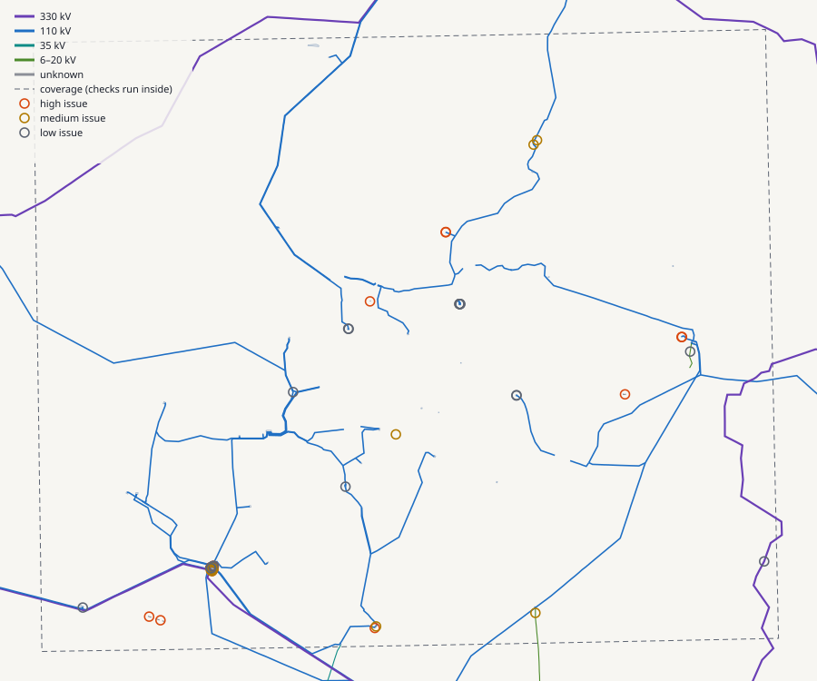

# Grid Intake Check

[](https://github.com/dmytromazurev/grid-intake-check/actions/workflows/ci.yml)

Pre-ingest QA for utility power-grid data. Point it at a GIS export of poles, towers, lines and substations and in under a second it tells you how ready the data is to build an engineering model from, what is wrong and where, and what to ask the utility for.

Python package · CLI · REST API · MCP server · [browser demo](https://dmytromazurev.github.io/grid-intake-check/)



## Why

Building a digital twin of an electricity network starts with the customer’s data: a GIS export, an asset register, LiDAR. Gaps in that data (no structure numbers, missing voltages, lines that stop in the air, structures in the wrong place) usually surface one at a time during model build. Each one becomes a question to the utility and a few days of waiting.

Grid Intake Check runs those checks in the first hour instead. It produces:

- a **readiness score** (0–100) split into attributes, topology and geometry;
- every **issue with coordinates**, as JSON, CSV, an SVG map or a standalone HTML report;
- a **register vs survey reconciliation** that separates mispositioned, missing and unrecorded structures, and finds systematic offsets;
- a **mapping from the customer’s codes to library types**, with report-formula snippets;
- a **draft data request** to the utility listing every gap with counts and examples.

## Results on real data

The bundled demo is the OpenStreetMap power grid around Vilnius (snapshot 2026-10-15): 1,275 structures, 189 line sections, 541 km, 34 substations. OSM stands in for a utility export; the issues it finds are real.

```text
$ gridintake check examples/vilnius-grid.geojson
vilnius-grid.geojson: 1,275 structures, 189 lines, 541.3 km, 34 substations · CRS EPSG:3346
Readiness 45/100  (attributes 24, topology 78, geometry 48)
  [HIGH] Lines without voltage                     25
  [ok  ] Unparseable voltage values
  [ok  ] Several voltages on one line
  [ok  ] Cables don’t match circuits
  [ok  ] Voltage changes at a line joint
  [HIGH] Dangling line ends                        13
  [MED ] Line vertices without a structure         42
  [MED ] Structures not on any line                 1
  [ok  ] Duplicate structures
  [MED ] Unusually long spans                       7
  [ok  ] Very short spans
  [low ] Notes left in the source data              1
Findings:
  - 1,275 of 1,275 structures (100%) have no structure number, so the model can’t be matched to the asset register or work orders yet.
  - Suspension vs tension is known for only 6% of structures; tension sections would have to be inferred from geometry.
  - 25 lines have no voltage, so clearance rules can’t be assigned to them.
  - 13 line ends stop in the open (not at a structure, substation or another line).
  - 7 spans are far longer than their voltage class allows for, which usually means missing structures.
```

## What it checks

| Check | How |
|---|---|
| Attribute completeness | Share of structures with a structure number, suspension/tension, material, design, height; lines with voltage, cables, circuits, name, operator. Each field says why the twin needs it. |
| Voltage | Missing, unparseable or several values on one line; V vs kV detected automatically. |
| Cables vs circuits | For 3-phase AC, cables = 3 × circuits. |
| Line ends | Each end is classified: on a structure (≤ 1 m), at a substation (≤ 30 m from the footprint), joining another line, or dangling. Ends near the data boundary are ignored so an extract cut doesn’t look like a gap. |
| Bends without a structure | Line vertices that sit on no structure: missing poles or digitising noise. |
| Orphans and duplicates | Structures on no line; two structures closer than 2 m. |
| Span outliers | Span = conductor between consecutive structures along a line. Longer than 2.5× the median of its voltage class, or shorter than 15 m. |
| Voltage change at a joint | Two line pieces meeting end to end with different voltages. |
| Source notes | `fixme` notes left in the data. |

All tolerances, required fields, field-name aliases, voltage classes, score weights and code mappings live in a YAML **rule pack** ([default](src/gridintake/rulepacks/default.yaml), [customer example](examples/rulepack-customer.yaml)), so one pack per customer is reused on every delivery.

Coordinates: GeoJSON is read as EPSG:4326 unless a legacy `crs` member or `--crs` says otherwise. Data is projected to a metric working CRS (LKS-94 / EPSG:3346 in Lithuania, the local UTM zone elsewhere, or the source CRS if it is already metric). A file in a projected CRS with no CRS declared is rejected with a message saying what to ask the customer for.

## Quick start

```bash
git clone https://github.com/dmytromazurev/grid-intake-check && cd grid-intake-check
uv venv && uv pip install -e ".[dev]"     # or: python -m venv .venv && pip install -e ".[dev]"
gridintake check examples/vilnius-grid.geojson --html out/report.html --csv out/issues.csv
```

```bash
gridintake check FILE [--crs EPSG:3346] [--rules pack.yaml] [--json|--csv|--svg|--html PATH] [--fail-under 80]
gridintake reconcile FILE (--detections survey.geojson | --simulate) [--tolerance 3]
gridintake formulas FILE
gridintake request FILE
gridintake rules [--show default]
gridintake serve            # REST API on :8000
gridintake mcp              # MCP server over stdio
```

`--fail-under` exits with code 1 when readiness is below the threshold, so the check can gate a pipeline step.

## REST API

```bash
gridintake serve                                   # or: docker build -t gic . && docker run -p 8000:8000 gic
curl -F file=@examples/vilnius-grid.geojson "http://127.0.0.1:8000/v1/check?issue_limit=5"
curl -F file=@examples/vilnius-grid.geojson "http://127.0.0.1:8000/v1/check?format=html" > report.html
curl -F file=@examples/vilnius-grid.geojson -F simulate=true http://127.0.0.1:8000/v1/reconcile
curl -F file=@examples/vilnius-grid.geojson -F 'mapping={"material":{"concrete":"CONC_12M"}}' http://127.0.0.1:8000/v1/formulas
curl -F file=@examples/vilnius-grid.geojson -F recipient=Ona http://127.0.0.1:8000/v1/customer-request
```

| Endpoint | Returns |
|---|---|
| `GET /health` | status and version |
| `GET /v1/rulepacks`, `GET /v1/rulepacks/{name}` | built-in rule packs |
| `POST /v1/check` | summary, checks, completeness, issues (`format=json\|csv\|html`) |
| `POST /v1/reconcile` | matched / mispositioned / missing / unrecorded / non-power, offsets, systematic shifts |
| `POST /v1/formulas` | value counts, mapping to library types, formula snippets |
| `POST /v1/customer-request` | the draft message as text |

Interactive docs at `/docs` (OpenAPI).

## MCP server

The same operations as tools for an AI assistant, so a deployment engineer can ask “check this export and draft the data request” in Claude Desktop, Claude Code or any MCP client.

```bash
claude mcp add grid-intake -- uvx --from "grid-intake-check[mcp] @ git+https://github.com/dmytromazurev/grid-intake-check" gridintake mcp
```

Claude Desktop (`claude_desktop_config.json`):

```json
{
  "mcpServers": {
    "grid-intake": {
      "command": "uvx",
      "args": ["--from", "grid-intake-check[mcp] @ git+https://github.com/dmytromazurev/grid-intake-check", "gridintake", "mcp"]
    }
  }
}
```

| Tool | Does |
|---|---|
| `check_grid_data` | readiness score, headline findings, checks, completeness |
| `list_issues` | issues filtered by check and severity, with coordinates |
| `reconcile_with_survey` | register vs detections (or simulated detections) |
| `generate_formulas` | value counts, mapping and formula snippets |
| `draft_customer_request` | the data request to the utility |
| `export_report` | writes an HTML, CSV or JSON report (the only tool that writes) |

Tools take local file paths; results are cached per file and modification time.

## Register vs survey reconciliation

Structures in the register are matched to survey detections (for example LiDAR classification output, as GeoJSON points) one-to-one within a tolerance:

1. candidate pairs within the tolerance, sorted by distance, paired greedily so two records can’t claim one detection;
2. a leftover record with a detection within 3× the tolerance is **mispositioned**, otherwise **missing**;
3. leftover detections are **unrecorded**, except non-power poles (`properties.class = "pole_np"`: street lights, signs);
4. mispositioned records are grouped by line; a shared shift vector is reported as one **systematic offset** (an old digitising source), to be fixed once at the source.

`--simulate` generates synthetic detections from the register (0.5 m noise, ~3.5% missed, one 110 kV line shifted ≈5 m, unrecorded structures on long spans, street-light false positives). It demonstrates the method and is labelled as synthetic everywhere it appears.

```text
$ gridintake reconcile examples/vilnius-grid.geojson --simulate
SIMULATED detections (synthetic, for demonstration only)
Tolerance 3.0 m · matched 1,208 · mispositioned 15 · missing 52 · unrecorded 12 · non-power poles 19
Matched offset median 0.57 m, P95 1.23 m, max 1.83 m
Systematic offset: 14 records on line 176323124 110kV OL Vilnius-Jašiūnai shifted ≈ 4.42 m E, -2.68 m N. One systematic error (e.g. an old digitising source): fix the source transform once and re-run.
```

## Formula snippets

`gridintake formulas` turns the code mapping into report formulas written with functions from [Neara’s public Formula language reference](https://knowledge.neara.com/en/collections/8356348-formula-language-reference) (`map_lookup`, `get_prop`, `try`, `if`, `let`, `find_unattached_poles`, unit literals):

```text
map_lookup(
  map("concrete", "CONCRETE_POLE",
      "metal", "STEEL_LATTICE",
      "wood", "WOOD_POLE"),
  get_prop(gis_properties, "material", "text"),
  "UNMAPPED"
)
```

Library type names come from the rule pack and are placeholders; field names such as `gis_properties` follow the reference’s examples and should be checked against a real project schema.

## Browser demo

[`web/`](web/) is the same checks in plain JavaScript with a pannable map, deployed to [GitHub Pages](https://dmytromazurev.github.io/grid-intake-check/). It runs entirely in the browser; uploaded files never leave the machine. `tests/test_parity.py` runs the JS engine in Node and asserts it produces exactly the same score and issue counts as the Python package.

Run it locally: `python -m http.server` in the repository root, then open `http://localhost:8000/web/`.

## Layout

```text
src/gridintake/
  io.py          load GeoJSON / Overpass / compact JSON, CRS handling, field aliases
  rules.py       YAML rule packs
  analyse.py     checks and readiness score
  reconcile.py   register vs survey matching, simulated detections
  formulas.py    code mapping and formula snippets
  request.py     customer data request
  report.py      CSV, JSON, SVG map, HTML report
  cli.py · api.py · mcp_server.py
  rulepacks/default.yaml
web/             browser demo (JS port of the same checks)
data/            OpenStreetMap extract used by tests and the demo
examples/        the same data as GeoJSON, a customer rule pack
scripts/         re-fetch the OSM extract, convert to GeoJSON
tests/           49 tests: one synthetic network per check, golden numbers on Vilnius, CRS, API, CLI, MCP over stdio, JS ↔ Python parity
```

## Development

```bash
uv pip install -e ".[dev]"
pytest -q
ruff check src tests scripts
python scripts/fetch_osm.py --bbox 54.58,25.00,54.82,25.50 --out data/vilnius-osm.json   # fresh OSM extract
```

CI runs lint and tests on Python 3.11–3.13, builds the Docker image and smoke-tests the API container.

## Limitations

- Heuristics are tuned on OpenStreetMap data; a real utility export needs its own rule pack (aliases, voltage classes, tolerances).
- 2D only: no heights, sag or clearance; those belong in the engineering model.
- Reconciliation needs detections as points; working from raw point clouds is out of scope.
- The bundled reconciliation demo uses synthetic detections.

## Roadmap

- Run as a pipeline step on upload, storing results next to the data.
- Diff between deliveries: what changed since the last export, what the customer fixed.
- PostGIS / DuckDB backend for networks with millions of structures.
- Issues exported as a layer that can be reviewed in a 3D model.

## Licence

Code: MIT. Data in `data/` and `examples/`: © OpenStreetMap contributors, [ODbL](https://www.openstreetmap.org/copyright).
